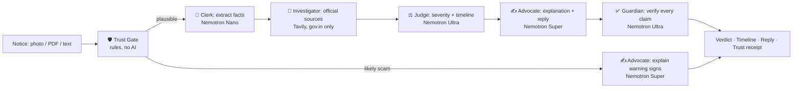

# 🛡️ Saakshi — the citizen's counter-agent for official notices

**Got a scary notice? Check it before you act.**

*Saakshi* (साक्षी) means "witness". Every official notice deserves a witness on the citizen's side.

**Live demo:** [ADD STREAMLIT URL] · **Video (3 min):** [ADD YOUTUBE URL] · **Track:** Best Apps and Agents

---

## The problem

Three things collided in 2026:

- **The state automated its notices.** Income tax notices are now largely system-generated by data matching. Gartner predicts at least 80% of governments will deploy AI agents for routine decisions by 2028.
- **Criminals forge that authority at scale.** Reported "digital arrest" scams in India rose from 39,925 cases in 2022 to 1,23,672 in 2024, with losses growing from ₹91 crore to ₹1,935 crore (MHA, reply to Parliament, March 2025).
- **The law itself changed.** The Income-tax Act 2025 replaced the 1961 Act on 1 April 2026, renumbering 819 sections into 536, while older years still follow the old Act.

The issuer has automation. The scammer has automation. The citizen has a confusing letter and fear. Panic leads to two failures: **paying fraudsters for things that are fake, and missing deadlines on things that are real.**

## What Saakshi does

Upload a photo, screenshot, PDF or text of any official-looking notice. Saakshi answers five questions, in this order:

1. **Is this real?** A rule-based Trust Gate runs *before* any AI interprets the notice.
2. **What does it actually say?** Plain language, in English, Hindi or Marathi, with read-aloud.
3. **How serious is it?** Routine / Action needed / Get a professional / Likely scam.
4. **What happens if I do nothing?** A step-by-step timeline.
5. **What do I do now?** A drafted reply, a document checklist, and where to respond. For scams: one tap to warn your family on WhatsApp.

## How it works



## How NVIDIA Nemotron and Nebius Token Factory are used

Every model call is a runtime call to the **Nebius Token Factory** API. Models are routed by difficulty, so the most expensive model runs only where judgment matters:

| Agent | Model | Job |
|---|---|---|
| Perceiver | Nemotron 3 Nano Omni | Reads photos and screenshots of notices (OCR + layout) |
| Clerk | `nvidia/NVIDIA-Nemotron-3-Nano-30B-A3B` | Extracts facts into strict JSON; flags scam patterns |
| Judge | `nvidia/Nemotron-3-Ultra-550b-a55b` | Decides severity and builds the "if you do nothing" timeline |
| Advocate | `nvidia/nemotron-3-super-120b-a12b` | Writes the explanation, reply draft and checklist |
| Guardian | `nvidia/Nemotron-3-Ultra-550b-a55b` | Verifies each claim (Chain-of-Verification) and removes unsupported ones |
| Investigator | Tavily API | Searches only official government sources, after personal data is redacted |

A full analysis costs about **$0.03**. A likely scam costs under **$0.01**, because Ultra and web search are skipped entirely.

## What makes it different

- **Verify before interpret.** Research on legal AI shows false premises make hallucinations worse, and a fake notice *is* a false premise. So deterministic rules run first: the Income Tax DIN (mandatory since October 2019), the official GSTIN checksum, personal-UPI payment demands, "digital arrest" and secrecy language. The AI can raise suspicion but can never overrule a rule-based scam verdict.
- **Scam X-ray.** Warning phrases are highlighted in red directly on the original notice, with the evidence quoted.
- **Deadlines are never hallucinated.** A deadline is shown only if its quote appears word-for-word in the notice.
- **A Guardian agent with a Trust Receipt.** Every claim is tagged as coming from the notice, an official source, or general guidance. Unsupported claims are removed, and the user sees how many.
- **Dual-law aware.** Knows whether the Income-tax Act 1961 or 2025 applies.
- **Private by default.** PAN, Aadhaar, phone numbers and emails are redacted before any web search. Nothing is stored.
- **Budget guard.** Every call is metered from real token counts; live calls stop at a hard spending cap, outputs are capped per model, and sample results replay at zero cost.
- **Knows its limits.** High-stakes notices (scrutiny, recovery, court) are marked "Get a professional", with free legal aid (NALSA 15100) and cyber-fraud (1930) helplines.

## Run it locally

Requires Python 3.10+.

```bash
git clone https://github.com/RajveerKondeti/saakshi
cd saakshi
pip install -r requirements.txt
cp .env.example .env          # Windows: copy .env.example .env
# paste your NEBIUS_API_KEY and TAVILY_API_KEY into .env
streamlit run app.py
```

Get keys from [Nebius Token Factory](https://tokenfactory.nebius.com) and [Tavily](https://app.tavily.com). Then click any example notice, or upload your own.

## Project structure

```
app.py                  Streamlit interface
pipeline/trust_gate.py  Deterministic authenticity rules (no AI)
pipeline/run.py         Perceive → Trust → Extract → Ground → Judge → Draft → Guard
core/llm.py             Token Factory client, model router, robust JSON parsing
core/budget.py          Cost meter and hard spending cap
core/prompts.py         All agent prompts
core/pii.py             Personal data redaction
samples/                Synthetic notices (no real personal data)
cache/                  Saved results so example demos cost nothing
docs/                   Full design spec and architecture
```

## Feedback on Nebius Token Factory and NVIDIA Nemotron

- **Token Factory:** The OpenAI-compatible API made setup fast; only the base URL changed. Having Nano, Super and Ultra under one key made routing by task difficulty simple. A per-key hard spending limit would help builders on fixed credits (I built my own budget guard), as would clearer docs on toggling reasoning mode per Nemotron 3 model.
- **Nemotron:** Ultra was strong at judgment and claim verification; Nano was fast and cheap for extraction. Nano sometimes wrote Indian-format numbers (e.g. `4,820`) inside JSON, which broke parsing. A strict JSON / structured-output mode would help.
- **Developer experience:** On Windows, Python file writes default to a non-UTF-8 encoding, which broke saving Hindi text. Worth a note in the quickstart.

## Roadmap

- Audio intake: upload a recording of a suspicious "officer" call (Nemotron 3 Nano Omni already supports audio)
- A WhatsApp front door, where most fake notices arrive
- All 22 scheduled Indian languages with voice output
- An anonymized "Notice Atlas" of fake-notice patterns, to help regulators and police spot new scams early

## Disclaimer

Saakshi is not a lawyer or chartered accountant. For high-stakes notices, consult a professional. Free legal aid in India: NALSA **15100**. Report cyber fraud: **1930** or cybercrime.gov.in.

## License

[MIT](LICENSE)
