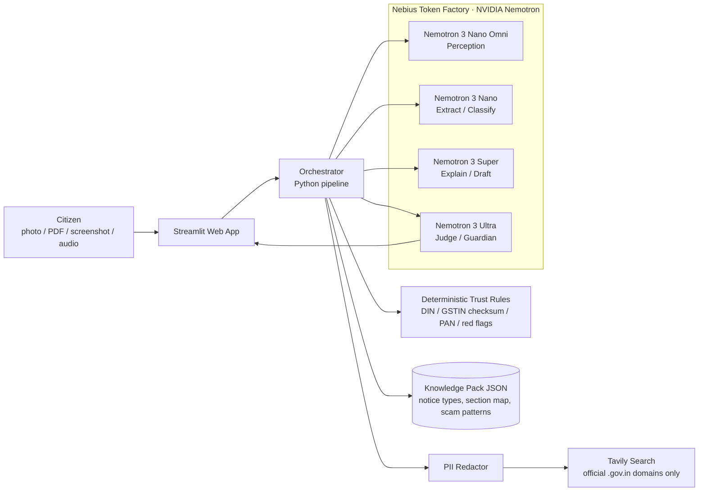
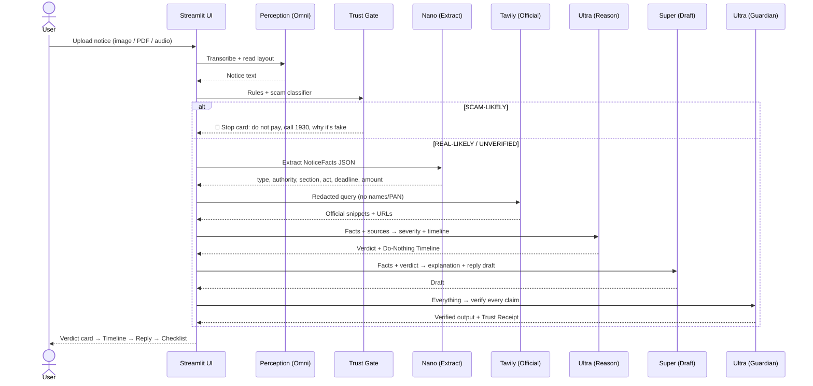

# Saakshi — The Citizen's Counter-Agent
### Design Doc · Architecture · Flow · Tech Spec
**Hackathon:** Nebius x NVIDIA Global AI Hackathon · **Track:** Best Apps and Agents
**Deadline:** Fri 30 Oct 2026, 10:00 PT = **22:30 IST tonight**

> *Saakshi* (साक्षी) means "witness". Every official notice deserves a witness on the citizen's side.

---

## 0. TL;DR

The state now generates notices with data analytics and AI. Criminals now forge notices to extort money. And in 2026 India runs two income-tax laws at once. A frightened citizen sits in the middle with nothing but a confusing letter.

**Saakshi** takes any official-looking demand (a photo of a letter, a PDF, a WhatsApp screenshot, even a **recorded phone call**) and answers five questions, in this order:

1. **Is this real?** A Trust Gate runs *before* any interpretation.
2. **What does it actually say?** Plain language, in the user's own language.
3. **How serious is it?** Routine / Respond / Get a professional / **Scam: do not pay**.
4. **What happens if I do nothing?** A "Do-Nothing Timeline".
5. **What do I do now?** A drafted reply, a document checklist, and the right escalation.

A **Guardian Agent** checks every claim before the user sees it. Anything it can't trace to the notice or to an official source is removed or flagged.

---

## 1. Problem Statement

> **Indian citizens receive a rising volume of machine-generated official notices, and an exploding volume of forged ones, but have no reliable, affordable way to tell them apart, understand them, or respond on time. Panic leads to two failures: paying fraudsters or middlemen for things that are routine, and missing deadlines on things that are serious.**

### Evidence

| Signal | Finding | Source |
|---|---|---|
| Notices are machine-generated | Notices are now largely system-generated from AIS/TIS data matching and risk parameters | TaxGuru (2026) |
| Scale example | ~1 lakh mismatch notices to high-income individuals in a single drive | Money9 / FinMin (2023) |
| Governments are automating | Gartner: ≥80% of governments will deploy AI agents to automate routine decision-making by 2028 | Gartner press release, Mar 2026 |
| Forged authority is a national crisis | "Digital arrest" cases: 39,925 (2022) → 1,23,672 (2024); losses ₹91 cr → ₹1,935 cr | MHA reply to Parliament, Mar 2025 |
| The Supreme Court is involved | SC noted over ₹3,000 cr lost to digital-arrest scams, mostly by the elderly | The Hindu, Nov 2025 |
| Overall cyber fraud | 1930 helpline logged 32.4M calls in 2025; I4C worst case ~₹1.2 lakh cr loss | Moneylife / I4C |
| The law itself just changed | Income-tax Act 2025 replaced the 1961 Act on 1 Apr 2026; 819 sections renumbered into 536; old years still use old sections | CBDT transition / Tax2win / KDK |
| Global justice gap | ~5.1B people have an unmet justice need; obstacles begin with recognising a problem as having a legal remedy | World Justice Project (2019), with OECD |
| AI alone is unsafe here | General LLMs hallucinated 58–88% on legal queries; even RAG legal tools 17–33% | Stanford RegLab: Dahl et al. 2024; Magesh et al. |

### The insight hiding in plain sight

There is now an **AI asymmetry**. The *issuer* (state or scammer) uses automation. The *recipient* uses fear and WhatsApp forwards. Notice tools exist for CAs and lawyers. **Nothing defends the citizen first and interprets second.**

### Who it's for (primary persona)

**Sunita, 58, Pune.** She received a "notice" PDF on WhatsApp threatening arrest over "money laundering on your PAN". Her son received an Income Tax intimation the same week. She can't tell which one is real. The scam is the one that tells her to act *today*.

---

## 2. Why this design is futuristic (and research-backed)

| # | Innovation | What it means | Grounded in |
|---|---|---|---|
| 1 | **Verify-before-Interpret** | Authenticity is checked *before* the LLM explains anything, so a fake notice never gets a "helpful" explanation | Stanford finding that false premises in a prompt make hallucinations worse; sycophancy as a major error type |
| 2 | **Any-modality intake** | Photo, scan, PDF, screenshot, or **audio of a scam call** go through one perception model | Nemotron 3 Nano Omni (text+image+audio+video, leads OCRBenchV2/MMLongBench-Doc) |
| 3 | **Dual-Law Resolver** | Detects whether a notice relates to the 1961 Act or the 2025 Act and maps the section numbers | 2026 transition; Stanford "temporal hallucination" finding: fix with live retrieval |
| 4 | **Do-Nothing Timeline** | Counterfactual reasoning: day 0 → deadline → +30 days, shown visually | Reasoning model (Ultra) used only where reasoning is needed |
| 5 | **Guardian Agent + Trust Receipt** | Every claim is tagged `[NOTICE]`, `[OFFICIAL SOURCE]`, or `[GENERAL GUIDANCE]`; untraceable claims are dropped | Gartner "guardian agents" concept; Chain-of-Verification (Meta, 2023) |
| 6 | **Cost-aware model cascade** | Nano for cheap steps, Super for writing, Ultra only for judgment | FrugalGPT (Stanford, 2023); the hackathon brief itself |
| 7 | **Know-your-limits escalation** | For high-stakes notices (summons, reassessment, SARFAESI), it says "get a professional" and routes to free legal aid | Access-to-justice research (WJP/OECD) |

---

## 3. Design Principles

1. **Safety before helpfulness.** Scam detection runs first, always.
2. **Cite or stay silent.** No claim without a source tag.
3. **Calm by design.** Lead with the verdict and next step, not walls of text.
4. **Honest limits.** Saakshi decodes and drafts. It never claims to be a lawyer, and it never auto-sends anything.
5. **Privacy by default.** Personal identifiers are never sent to web search. Nothing is stored.
6. **One screen, one story.** Upload → Verdict card → Details. That's the whole UX.

---

## 4. System Architecture (high level)



---

## 5. Layered Architecture

| Layer | Name | Responsibility | Implementation | Tonight? |
|---|---|---|---|---|
| **L0** | Experience | Upload, verdict card, timeline, reply draft, language toggle | Streamlit | ✅ |
| **L1** | Perception | Turn any input into clean text + layout notes | Nemotron 3 Nano Omni (images/audio); `pypdf` for digital PDFs | ✅ images+PDF · ⭐ audio |
| **L2** | Trust Gate | Decide REAL-LIKELY / UNVERIFIED / SCAM-LIKELY before anything else | Deterministic rules + Nano classifier | ✅ |
| **L3** | Understanding | Classify notice type, extract facts (deadline, amount, section, authority), resolve 1961 vs 2025 Act | Nano → structured JSON; knowledge pack | ✅ |
| **L4** | Grounding | Fetch current official guidance for this notice type | Tavily (`include_domains` = official sites), after PII redaction | ✅ |
| **L5** | Reasoning | Severity verdict + Do-Nothing Timeline | Ultra | ✅ |
| **L6** | Action | Plain-language explanation, reply draft, document checklist, escalation contacts | Super | ✅ |
| **L7** | Guardian | Verify each claim against notice text and sources; attach Trust Receipt; downgrade confidence | Ultra (Chain-of-Verification prompt) | ✅ |
| **X** | Cross-cutting | PII redaction, agent trace panel, model-cost router, error fallbacks | Python utils | ✅ trace · ⭐ cost meter |

⭐ = stretch goal / video vision only.

---

## 6. End-to-End Flow



**Step by step**

1. **Intake.** User uploads a file or records/uploads audio, and picks an output language (English / Hindi / Marathi).
2. **Perceive.** Omni reads it. Digital PDFs use direct text extraction (cheaper and exact).
3. **Trust Gate.** Rules run first (section 9). If a scam is likely, the pipeline **stops** and shows the scam card.
4. **Extract.** Nano returns `NoticeFacts` (strict JSON).
5. **Resolve law.** The tax year decides 1961 vs 2025 Act; the knowledge pack maps the section.
6. **Ground.** A redacted Tavily query, restricted to official domains.
7. **Reason.** Ultra produces the severity tier and the Do-Nothing Timeline.
8. **Act.** Super writes the plain explanation, reply draft, and checklist.
9. **Guard.** Ultra verifies each sentence, tags its source, and removes anything unsupported.
10. **Show.** The verdict card first, then details, with an "Agent Trace" expander showing which model did what.

---

## 7. Agent & Model Routing

| Agent | Model (Token Factory ID) | Why this model | Output |
|---|---|---|---|
| Perceiver | Nemotron 3 Nano Omni *(confirm exact ID)* | Best-in-class open document OCR; native audio | `raw_text` |
| Clerk | `nvidia/NVIDIA-Nemotron-3-Nano-30B-A3B` | Fast, cheap, good at structured extraction | `NoticeFacts`, scam signals |
| Investigator | Tavily API | Live, official-domain grounding | `sources[]` |
| Judge | `nvidia/Nemotron-3-Ultra-550b-a55b` | Deep reasoning for severity + counterfactual | `Verdict`, `Timeline` |
| Advocate | `nvidia/nemotron-3-super-120b-a12b` | Strong writing at mid cost; long context | explanation, reply, checklist |
| Guardian | `nvidia/Nemotron-3-Ultra-550b-a55b` | Verification needs the strongest reasoner | `TrustReceipt` |

**Fallback:** if Ultra is slow or fails, fall back to Super and mark "reduced confidence" in the UI.

---

## 8. Data Contracts

```json
// NoticeFacts (from Clerk)
{
  "notice_family": "income_tax | gst | bank_recovery | court_summons | utility | unknown",
  "notice_type": "e.g. 143(1) intimation, 143(2) scrutiny, DRC-01, SARFAESI 13(2)",
  "issuing_authority": "string",
  "reference_ids": {"din": "string|null", "gstin": "string|null", "case_no": "string|null"},
  "tax_or_assessment_year": "string|null",
  "law_regime": "IT_ACT_1961 | IT_ACT_2025 | NA | unclear",
  "sections_cited": ["string"],
  "amount_demanded_inr": "number|null",
  "response_deadline": "YYYY-MM-DD|null",
  "deadline_quote": "exact text from notice",
  "required_actions": ["string"],
  "delivery_channel_claimed": "portal | email | post | whatsapp | phone | unknown"
}
```

```json
// TrustVerdict (from Trust Gate)
{ "status": "REAL_LIKELY | UNVERIFIED | SCAM_LIKELY",
  "red_flags": [{"flag": "string", "evidence": "quote"}],
  "checks": {"din_present": true, "gstin_checksum_valid": null, "payment_to_personal_account": false},
  "how_to_verify_officially": "string" }
```

```json
// Verdict (from Judge)
{ "tier": "ROUTINE | RESPOND | PROFESSIONAL | SCAM",
  "one_line": "string", "why": "string",
  "timeline": [{"when": "Today | Deadline | +30d", "what_happens": "string", "source_tag": "NOTICE|OFFICIAL|GENERAL"}] }
```

```json
// TrustReceipt (from Guardian)
{ "claims": [{"text": "string", "tag": "NOTICE|OFFICIAL|GENERAL", "evidence": "quote or URL", "kept": true}],
  "removed_claims": 0, "confidence": "HIGH | MEDIUM | LOW" }
```

---

## 9. Trust Gate Rules (deterministic, run before any LLM)

| Check | Logic | Effect |
|---|---|---|
| DIN present (Income Tax) | Since 1 Oct 2019, IT communications must carry a DIN; a notice without a valid DIN is treated as invalid | Missing → **UNVERIFIED** plus "verify on the e-filing portal: Authenticate Notice" |
| GSTIN checksum | 15-character format + mod-36 check digit | Invalid → strong red flag |
| PAN format | `AAAAA9999A` pattern | Malformed → red flag |
| Payment channel | Demand to UPI/personal account, crypto, gift cards | → **SCAM_LIKELY** |
| Coercion language | "digital arrest", "stay on video call", "don't tell anyone", "arrest within hours" | → **SCAM_LIKELY** (no agency arrests over phone/video calls) |
| Channel mismatch | "CBI/ED/court" delivered only via WhatsApp; non-`gov.in` sender | Red flag |
| Urgency vs law | Deadline in hours rather than days | Red flag |

The LLM classifier adds pattern judgment on top. **Rules can escalate to SCAM; the LLM cannot downgrade a rule-triggered SCAM.**

**Scam card shows:** what's fake and why (quoted evidence), "Do not pay. Do not share OTP", report at **1930** / cybercrime.gov.in, and how to verify officially.

---

## 10. Guardian Protocol (Chain-of-Verification)

1. Split the draft output into atomic claims.
2. For each claim, ask: *Is this supported by the notice text, an official source retrieved this session, or is it general guidance?*
3. Tag it `[NOTICE]` / `[OFFICIAL]` / `[GENERAL]`. If unsupported, delete or rewrite it as uncertain.
4. Deadlines and amounts **must** be `[NOTICE]`, quoted verbatim, or they are not shown.
5. Output confidence: HIGH (all key facts tagged NOTICE/OFFICIAL), MEDIUM, or LOW.
6. Always append: *"Saakshi is not a lawyer or CA. For PROFESSIONAL-tier notices, consult one. Free legal aid: NALSA 15100."*

---

## 11. Privacy & Safety

- **PII redaction** (names, PAN, Aadhaar, phone, addresses, account numbers) before any Tavily query. Web search only sees things like "143(1) intimation response process".
- **No storage.** Files are processed in memory; there is no database.
- **No auto-actions.** Saakshi never submits, pays, or emails on the user's behalf.
- **Demo data** is synthetic. No real person's notice appears in the repo or video.

---

## 12. Tech Stack & Repo Layout

| Concern | Choice | Reason |
|---|---|---|
| Language | Python 3.11 | Simplest for a beginner |
| UI | Streamlit | Polished UI with almost no front-end code |
| LLM client | `openai` SDK → Token Factory base URL | OpenAI-compatible API |
| Search | `tavily-python` | Bonus prize + grounding |
| Schemas | `pydantic` | Strict JSON validation of model outputs |
| PDF | `pypdf` | Text from digital PDFs |
| Deploy | Streamlit Community Cloud (free) | Live demo URL in minutes |
| Optional | Nebius Serverless Endpoint | Encouraged by the track, not required |

```
saakshi/
├── app.py                  # Streamlit UI (L0)
├── pipeline/
│   ├── perceive.py         # L1  Omni + pypdf
│   ├── trust_gate.py       # L2  rules + classifier
│   ├── understand.py       # L3  NoticeFacts + law resolver
│   ├── ground.py           # L4  redaction + Tavily
│   ├── reason.py           # L5  verdict + timeline
│   ├── act.py              # L6  explanation + reply
│   └── guardian.py         # L7  verification + receipt
├── core/
│   ├── llm.py              # Token Factory client + model router + fallback
│   ├── schemas.py          # pydantic models (section 8)
│   ├── pii.py              # redaction
│   └── prompts.py          # all prompts in one place
├── knowledge/
│   ├── notice_types.json   # common notice types, typical meaning
│   ├── section_map.json    # 1961 ↔ 2025 sections used in common notices
│   └── scam_patterns.json
├── samples/                # 5 synthetic notices (section 13)
├── .env.example
├── requirements.txt
├── LICENSE                 # MIT
└── README.md
```

---

## 13. Golden Test Set (synthetic samples)

| # | Sample | Expected tier | Proves |
|---|---|---|---|
| 1 | IT 143(1) intimation, small mismatch, DIN present | ROUTINE / RESPOND | Calm, correct triage |
| 2 | IT 143(2) scrutiny notice | PROFESSIONAL | Knows its limits |
| 3 | GST DRC-01 show-cause with GSTIN | RESPOND | Second notice family |
| 4 | Fake "CBI digital arrest" letter (WhatsApp image) | **SCAM** | The wow moment |
| 5 | Audio clip of a fake "customs officer" call | **SCAM** | ⭐ Futuristic multimodal |

---

## 14. Scope: Tonight MVP vs Vision

| Tonight (must ship) | Vision (show in video as roadmap only) |
|---|---|
| Image + PDF intake | Live audio intake from phone calls |
| Trust Gate (rules + Nano) | WhatsApp bot front door |
| Extract → Ground → Verdict → Reply | Notice Atlas: anonymized patterns of fake vs real notices for regulators |
| Guardian + Trust Receipt | Fine-tuned Nemotron on Indian notice corpus |
| English + Hindi output | All 22 scheduled languages, voice output |
| Agent Trace panel | Deadline reminders, Nebius Serverless Jobs for batch analysis |

**Rule:** if time is short, cut from the bottom of the Tonight column, but **never cut the Trust Gate or the scam sample.** That's the idea judges will remember.

---

## 15. Mapping to Judging Criteria

| Criterion (25% each) | How Saakshi wins it |
|---|---|
| Technological Implementation | 4 Nemotron models routed by task difficulty; Tavily grounding; deterministic + LLM hybrid; guardian verification |
| Design | One calm verdict card; timeline visual; language toggle; trace panel |
| Potential Impact | Specific victims (elderly, small traders), quantified scam losses, Supreme Court-level urgency |
| Quality of Idea | Verify-before-Interpret: the citizen's counter-agent in the age of automated state notices and forged authority |

## 16. Submission Checklist

- [ ] Public GitHub repo, **MIT license visible in the About section**
- [ ] README: setup, how to run, **where each Nemotron model is used**, how Token Factory and Tavily are used
- [ ] Live demo URL (Streamlit Cloud) with one-click sample notices
- [ ] YouTube video < 3 min, public, no copyrighted music
- [ ] Track: Best Apps and Agents
- [ ] Feedback section on Token Factory / Nemotron (keep notes while building)
- [ ] Submit with **≥ 1 hour buffer** before 22:30 IST

## 17. Demo Video Script (≤ 3:00)

| Time | Shot |
|---|---|
| 0:00–0:25 | The problem: Sunita gets two notices in one week, one real and one fake. Show the digital-arrest numbers on screen. |
| 0:25–1:10 | Upload the fake CBI letter → red SCAM card with quoted evidence → "call 1930". |
| 1:10–2:05 | Upload the real 143(1) intimation → verdict ROUTINE → Do-Nothing Timeline → reply draft in Hindi → Trust Receipt. |
| 2:05–2:35 | Open the Agent Trace: Omni → Nano → Tavily → Ultra → Super → Guardian on Token Factory. |
| 2:35–3:00 | Vision: audio calls, WhatsApp, Notice Atlas. Closing line: *"The state has an AI. The scammer has an AI. Now the citizen does too."* |

## 18. Risks & Mitigations

| Risk | Mitigation |
|---|---|
| Ultra latency during demo | Super fallback; pre-record the video from a successful run |
| Wrong legal detail | Guardian tagging; deadlines only shown verbatim from the notice; disclaimer |
| Omni ID differs / not available | Fall back to pypdf + typed text input for samples |
| Running out of time | Strict scope in section 14; deploy early, polish later |

---

## 19. Sources

- Gartner, "At Least 80% of Governments Will Deploy AI Agents…", press release, 17 Mar 2026
- Gartner, guardian agents predictions (2024–2025 press releases)
- Ministry of Home Affairs reply to Parliament on digital-arrest cases, Mar 2025 (via Inc42 / Kuvera)
- Moneylife, cyber-fraud losses 2025 (1930 helpline, I4C estimate)
- World Justice Project, *Measuring the Justice Gap* (2019), with OECD methodology
- Stanford RegLab: Dahl et al., "Large Legal Fictions" (arXiv:2401.01301); Magesh et al., "Hallucination-Free?"
- Dhuliawala et al., "Chain-of-Verification Reduces Hallucination in LLMs", Meta AI (arXiv:2309.11495)
- Chen, Zaharia, Zou, "FrugalGPT" (arXiv:2305.05176)
- NVIDIA, "Nemotron 3 Nano Omni" (arXiv:2604.24954; Hugging Face blog, Apr 2026)
- CBDT Circular 19/2019 on DIN; e-filing portal "Authenticate Notice"
- Income-tax Act 2025 transition guides (CBDT mapping utility; Tax2win; KDK)
